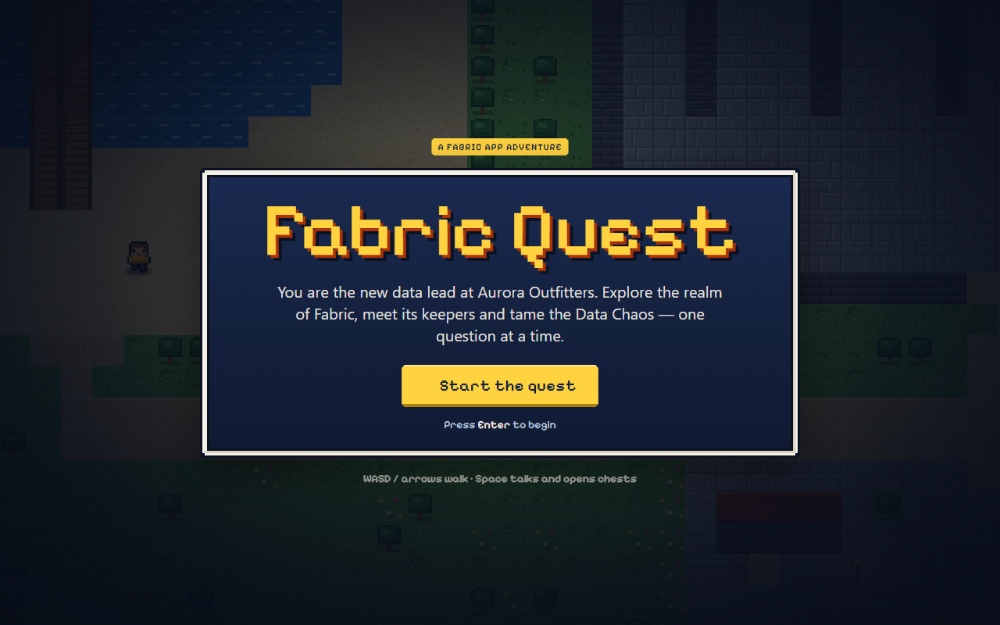
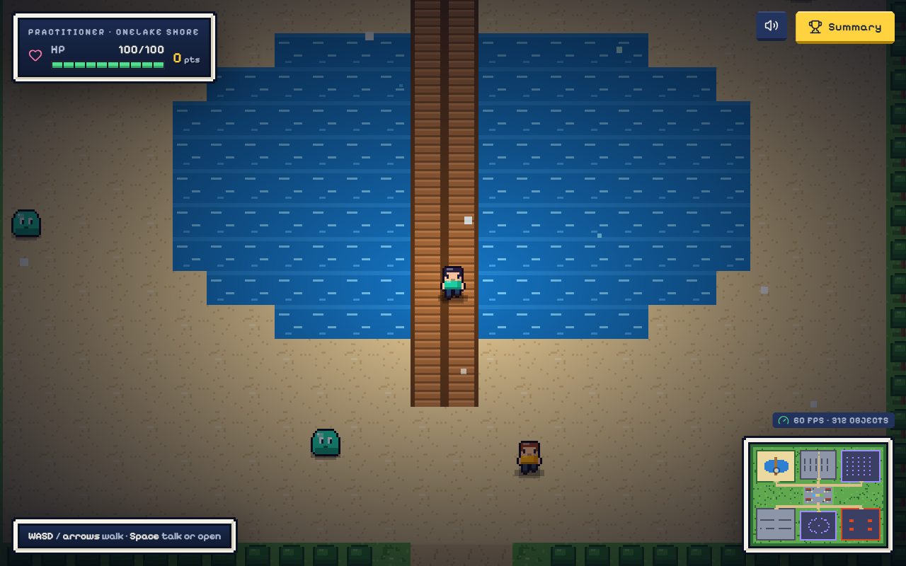
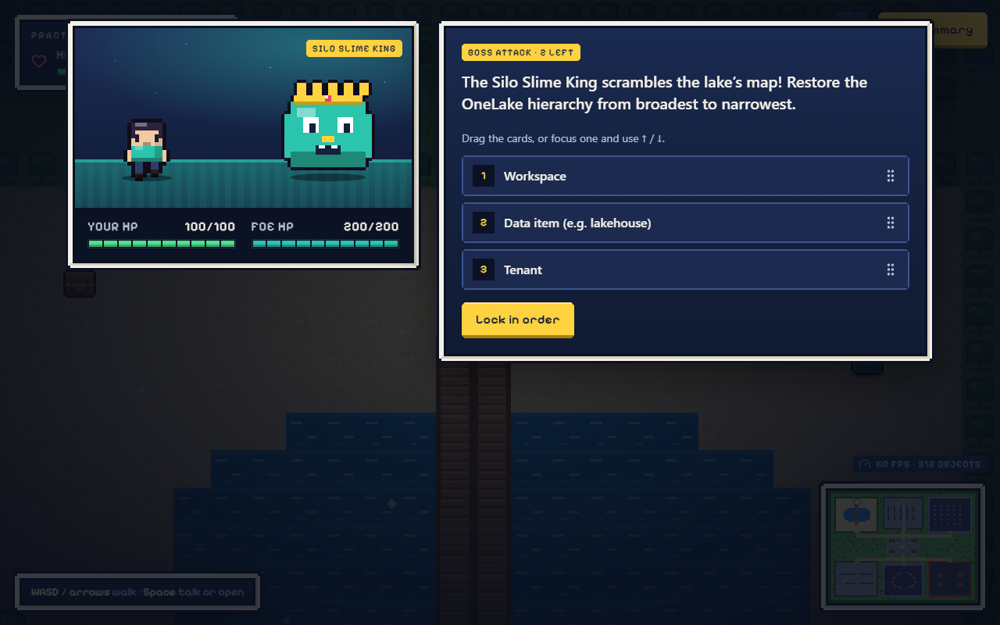

# Fabric Quest

**A pixel-art JRPG that teaches Microsoft Fabric, built as a Fabric App.**

You are the new data lead at Aurora Outfitters. Explore a world of six regions (OneLake, Data Factory, semantic models, governance, Fabric IQ and Fabric Apps), talk to the people who look after each place, open chests, and tame the *Data Chaos* in turn-based battles where every attack is a question. Pick a difficulty that matches your experience, from people new to data tools to people who run Fabric for a living.

The game also shows how far a Fabric App can go. It runs a real-time game engine, generated pixel art and sound, lighting and particles, and charts, all inside a React app that sits behind Fabric sign-in.



| Explore the world | Battle with knowledge |
| --- | --- |
|  |  |

## Features

- **Six regions, one per topic.** Each has a keeper with a story, roaming creatures, two treasure chests and a boss.

  | Region | Topic |
  | --- | --- |
  | OneLake Shore | OneLake, shortcuts, mirroring and open formats |
  | Data Factory Foundry | Copy job, Mirroring, pipelines, Dataflow Gen2 and Eventstreams |
  | Semantic Spire | Import, DirectQuery and Direct Lake |
  | Governance Citadel | Workspace roles, endorsement and sensitivity labels |
  | IQ Observatory | Fabric IQ and ontologies |
  | App Forge | Fabric Apps and their real limits |

- **Turn-based battles.** A correct answer deals damage and a wrong one costs you HP. Bosses use ordering, matching and chart puzzles. If you faint, you wake up at the hub and keep your answers.
- **Three difficulties.** Beginner (with hints), Practitioner and Expert each draw a different set of questions.
- **Facts you can trust.** Every answer explains why and links to its source on Microsoft Learn.
- **Showcase visuals, all generated in code:**
  - a shared pixel UI kit
  - outlined, shaded sprites with drop shadows
  - animated water and lava
  - glowing lamps, lava and crystals
  - per-region particles and colour grading
  - a cinematic title over the live world
  - chiptune sound effects
- **A live engine readout.** The FPS and object counter on screen is a reminder that this is a Fabric App.
- **Accessible.** The game can be played with the keyboard alone. Menus use roving focus, screen-reader roles and labels are in place, and `prefers-reduced-motion` turns off shake, panning and particles.

### Controls

| Key | Action |
| --- | --- |
| WASD or arrow keys | Walk |
| Space or Enter | Talk to a character or open a chest |
| ↑ / ↓ and Enter | Choose an answer in battle |
| ↑ / ↓ on a focused card | Reorder cards in an ordering puzzle |

## Quick start

You need **Node.js 22.13 or later**.

```sh
npm install
```

### Option A: fully local, no Fabric needed

[rayfin-local](https://github.com/spatney/rayfin-local) runs the app's whole backend on your machine and stands in for Fabric sign-in. It is a community project (MIT licence), not an official Microsoft product. Install it as its README describes, then start the app from the repository root:

```sh
rayfin-local serve
```

Open <http://localhost:5173/>. You are signed in automatically, and nothing is deployed to Fabric.

### Option B: against a Fabric backend

```sh
npx rayfin login
npm run dev
```

`npm run dev` uses the Fabric backend provider and creates a missing app backend in your workspace. See the [Rayfin CLI guide](node_modules/@microsoft/rayfin-guide/assets/docs/cli/quickstart.md), installed with the dependencies.

## How it's built

| Layer | Technology |
| --- | --- |
| App platform | Rayfin / Fabric Apps (React 19 + Vite), protected hosting, Fabric sign-in |
| Game world | Phaser 4: tilemap, arcade physics, camera, particles, WebGL filters |
| UI | React overlays, framer-motion and Tailwind v4 tokens, in a custom pixel UI kit |
| Charts | Microsoft Fabric visuals (`VegaVisual`) |
| Tests | Vitest + Testing Library |

React owns the game state and every window. Phaser owns the world. The two talk through a small typed event bus: the world reports what the player touched, and the UI sends back commands such as `pause`, `remove-creature` and `respawn`.

```text
packages/frontend/src/game/
├── GameApp.tsx              # Screen flow: title → difficulty → world ↔ summary
├── useGame.ts               # Top-level game state (campaign survives screen changes)
├── engine.ts                # Scoring and difficulty filtering
├── content/                 # Six verified chapters of questions, one file per region
├── scenes/                  # Puzzle pieces reused in battles (feedback, ordering, matching, chart)
├── screens/menus.tsx        # Title, save slots, quest log
└── rpg/
    ├── campaign.ts          # Battles, HP, bosses, region clearing (pure, tested)
    ├── world.ts             # The 96×72 tile map, regions, NPCs, chests (pure, tested)
    ├── sound.ts             # WebAudio chiptune effects
    ├── phaser/              # WorldScene, generated textures, event bus, React mount
    └── ui/                  # Pixel UI kit, HUD, battle, dialogue, chest card, attract mode
```

No image or audio files ship with the game. Every tile, sprite, glow and sound is generated at runtime, which keeps the art original and the bundle free of binary assets.

## Content and fact checking

The questions live in `packages/frontend/src/game/content/`. Each one has the correct answer, an explanation and a `source`:

- For OneLake, Data Factory, semantic models, governance and Fabric IQ, the source is a `learn.microsoft.com` page.
- For the App Forge (Fabric App limits), the source is the Rayfin guide that ships with the project (`rayfin-docs:…`).

Facts were checked against those sources when they were written, and anything that couldn't be verified was dropped. `content.spec.ts` enforces the structure:

- every question has an explanation and an allowed source
- every region has at least four questions per difficulty, with both creature questions and boss puzzles
- answers are well-formed
- explanations contain no stray markup

## The Fabric App limits it teaches

The App Forge turns real platform limits into challenges. The facts come from the installed Rayfin guide:

- Collection queries return one page (100 records by default), so long lists must page through results.
- Eventhouse (KQL) connector authoring is held in this release.
- Many-to-many relationships need an explicit join entity.
- `count()` isn't available on the fluent GraphQL client.
- The compressed static hosting upload is limited to 100 MB.
- Function invocations are capped at 250 seconds.
- `@text()` fields should set a `max`.
- Anonymous data access needs a tenant admin setting.

## Quality checks

Run these from the repository root, one at a time:

```sh
npm run typecheck
npm run build
npm run lint
npm test
npm run validate:visual
```

`npm test` runs the game logic, content guarantees, world map reachability, battle flow, the keyboard command menu, and the authentication gate. Phaser itself is stubbed in unit tests and checked in the browser.

### All root commands

| Command | What it does |
| --- | --- |
| `npm run dev` | Starts Rayfin services (Fabric backend) and the frontend dev server. |
| `npm run dev:frontend` | Starts only the frontend dev server. |
| `npm run build` | Builds shared contracts, data definitions and the frontend in order. |
| `npm run build:fabric` | Builds with the frontend's Fabric packaging behaviour. |
| `npm run typecheck` | Type-checks the referenced workspace projects. |
| `npm run lint` | Lints the frontend package. |
| `npm test` | Runs the frontend test suite. |
| `npm run validate:visual` | Checks chart specifications offline. |
| `npm run rayfin:up` | Provisions or updates the app's Fabric resources. |

## Deploying to Fabric

Deployment is optional. Fabric Quest runs fully locally. When you're ready, sign in, preview the target workspace, and then deploy:

```sh
npx rayfin login
npm run rayfin:up
```

Hosted assets stay protected (`assetAccess: protected`), and the game is only reachable after Fabric sign-in. Follow the installed Rayfin CLI guide for workspace selection and deployment options.

## Credits

- Built on the Rayfin **Universal App** template for Fabric Apps.
- Questions verified against [Microsoft Learn](https://learn.microsoft.com/fabric/) and the Rayfin guide.
- The world, characters and sounds are original and generated in code. The story company, Aurora Outfitters, is fictional, and so is the data shown in the chart questions.
- Released under the [MIT License](LICENSE).
